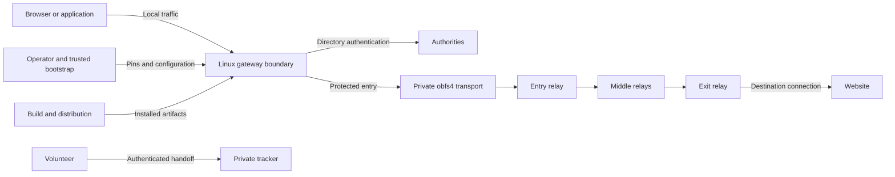

# AnonGuard v6 threat model

## Executive summary

AnonGuard is an experimental low-latency TCP onion gateway, not an approved
public-anonymity product. Authentication, replay refusal, bounded admission and
Linux containment raise the cost of specified attacks. End-to-end correlation,
operator concentration, compromised endpoints and distribution compromise remain
important risks. This model maps implementation and evidence; it is not a full
security audit, a proof of anonymity or a claim of superiority to Tor.

Reviewed 16 October 2026 against runtime baseline `21b4a93`, the subsequent VM
validation record, and the protected-egress regression in this working tree.
Evidence below distinguishes source controls, narrow fixtures and open release
acceptance. Rankings describe threat scenarios, not confirmed vulnerabilities.

## Scope and assumptions

- User-confirmed purpose: independent public-anonymity project and practical FYP;
  Linux client/browser and volunteer relays; VMs are optional test fixtures.
- Runtime: `src/`, native setup/adapter, application launcher, browser tooling and
  obfs4 supervisor. Build/distribution: workflows, Debian packaging and release
  verification. Tests/evaluators produce evidence; they are not defenses themselves.
- Authentic bootstrap pins, uncompromised client OS, protected security state,
  sufficiently reliable clocks and maintained dependencies are prerequisites.
- Production expects independent authority/relay operators and actual users. The
  current single-operator VM fixture does not satisfy those assumptions.
- Windows/macOS kernel containment, private onion services and reverse onion
  circuit transport are not implemented production capabilities.
- Still unknown: deployment size, independent operator/family relationships,
  signing identities, operational ownership, bandwidth budget and incident-response
  commitments. These affect availability, Sybil and supply-chain risk rankings.

## System model

### Primary components

Rust CLI client/gateway and relays construct bounded 3–8-hop circuits (CLI default
3–5), using persisted guards and authenticated directory views. Authorities sign
exact snapshots. The optional tracker provides private reverse handoff, not onion
services. Native Linux tooling installs a transparent TCP adapter and firewall;
separate headless-app containment uses a private rootfs. Browser tooling generates
Firefox policy and origin-context attribution. Evidence: `src/main.rs`,
`src/onion/`, `src/mesh/`, `scripts/device_setup.py`, `scripts/native_adapter.py`,
`scripts/anonguard_run_app.py`, `scripts/browser_session.py`.

### Data flows and trust boundaries

- Browser/application → local gateway/adapter: SOCKS credentials, destinations and
  payload over local TCP. Browser context attribution and generated UID/firewall
  restrictions constrain this edge. Local administrators remain trusted.
- Client → authorities: bootstrap-pinned hybrid authenticated directory transport;
  bounded documents, freshness, exact-snapshot quorum and persisted rollback checks.
  Distinct keys do not establish independent operators. Evidence:
  `src/mesh/directory_client.rs`, `src/mesh/transport.rs`, `src/mesh/consensus.rs`.
- Gateway → entry → middles → exit: pinned TLS 1.3, hybrid key exchange,
  exporter-bound dual identity proofs, authenticated onion cells and covered links.
  Each relay knows adjacent endpoints. Evidence: `src/onion/transport.rs`,
  `src/onion/circuit.rs`, `src/onion/link_cover.rs`.
- Exit → destination: validated DNS results and TCP connection; destination HTTPS
  remains necessary. Exit policy does not make plaintext confidential. Evidence:
  `src/kernel/exit_policy.rs`, `src/kernel/dns.rs`.
- Gateway → private obfs4 supervisor → provisioned bridge/authority endpoints:
  authenticated private configuration, systemd credentials and dedicated PT UID.
  Protected native output confines gateway to loopback and PT to provisioned
  IPv4 endpoint/port pairs. Explicit direct-lab mode is separate. Evidence:
  `scripts/device_setup.py`, `scripts/pt_supervisor.py`.
- Volunteer → tracker: distinct authenticated channel, composite ownership proofs,
  private capabilities, bounded control frames/queues and deadlines. Tracker sees
  participants and handoffs. Evidence: `src/mesh/tracker.rs`.
- Operator → privileged setup/security state: trusted files, identity keys, pins,
  guards, authority votes and retirement policy. Root can replace these or disable
  controls. Evidence: `src/core/storage.rs`, `src/core/revocation.rs`.
- Maintainer/build → installed product: package, browser addon, bootstrap and release
  artifacts. Manifest verification exists; actual signing/distribution ceremonies
  remain release prerequisites. Evidence: `scripts/verify_release.py`, `.github/`.

#### Diagram

## Assets and security objectives

| Asset | Why it matters | Security objective |
| --- | --- | --- |
| Client IP and destination relationship | Disclosure can identify activity | Confidentiality |
| Browser contexts and application payload | Cross-context linkage or content disclosure | Confidentiality, integrity |
| Identity keys, pins and retirement policy | Impersonation or malicious trust changes | Confidentiality, integrity |
| Directory snapshots, votes and guards | Path control, rollback and excess guard exposure | Integrity, availability |
| CPU, memory, sockets and cover bandwidth | Exhaustion denies service and can alter observable traffic | Availability |
| Packages, addon and updates | Malicious distribution can bypass all runtime controls | Integrity |

## Attacker model

### Capabilities

Local network observation; adaptive traffic classifiers; colluding ingress/egress
observers; malicious relays; funded Sybil registration; active delay/drop/probing;
unauthenticated malformed messages and connection floods; malicious destinations;
malicious application content; and attempted package/bootstrap substitution.
Authority-quorum compromise and client-root compromise are separate severe
scenarios, not assumed capabilities of every remote peer.

### Non-capabilities

An ordinary remote peer is not assumed to read local key files, modify root-owned
rules, forge uncompromised cryptographic signatures or control an authority quorum.
A compromised OS/root is outside the routing confidentiality guarantee. Neither
more hops nor dummy bytes create independent users or prevent global observation.

## Entry points and attack surfaces

| Surface | How reached | Boundary | Notes | Evidence |
| --- | --- | --- | --- | --- |
| SOCKS and transparent adapter | Local applications | Application/gateway | Context, destination and DNS parsing | `src/gateway/server.rs`, `scripts/native_adapter.py` |
| Relay handshake/cells | Network sockets | Peer/relay | Pins, proofs, framing, flow state | `src/onion/transport.rs`, `src/onion/cell.rs`, `src/onion/flow.rs` |
| Directory/registration | Network sockets | Peer/authority | Quorum, freshness, PoW, ownership | `src/mesh/authority.rs`, `src/mesh/node.rs` |
| Reverse tracker | Network sockets | Volunteer/tracker | Bounded control/registration/handoff | `src/mesh/tracker.rs`, `src/mesh/admission.rs` |
| Exit DNS/connect | Requested destination | Exit/destination | Reject private/special resolved addresses | `src/kernel/exit_policy.rs` |
| Native setup and PT config | Operator files/CLI | User/root/services | Digest, schema, protected credentials | `scripts/device_setup.py`, `scripts/pt_supervisor.py` |
| Browser/addon | Web content and local installation | Browser/gateway | Context attribution and locked policy | `scripts/browser_session.py`, `browser/isolation/` |
| State and release inputs | Files/artifacts | Operator/installed code | Durable state, signatures and permissions | `src/core/storage.rs`, `scripts/verify_release.py` |

## Top abuse paths

1. Observe client and destination → align timing/volume → link activity despite encryption.
2. Train on defended sessions → exploit lifetime/congestion signals → infer visited activity.
3. Register related relays → influence paths or induce guard churn → increase observation opportunities.
4. Send partial or expensive handshakes → hold admissions/resources → deny legitimate users.
5. Cause PT/gateway failure or network change → exploit an installation gap → attempt direct egress.
6. Serve identifying browser content or induce account login → link contexts without breaking crypto.
7. Substitute bootstrap/update artifacts → gain trusted execution or path control.
8. Request internal destinations or tamper/replay protocol messages → attack exit networks or circuit integrity.

## Threat model table

Likelihood is conditional on the stated capability; impact concerns exposed users.
Priority is residual engineering/release priority, not a vulnerability severity claim.

| Threat ID | Threat source | Prerequisites | Threat action | Impact | Impacted assets | Existing controls (evidence) | Gaps | Recommended mitigations | Detection ideas | Likelihood | Impact severity | Priority |
| --- | --- | --- | --- | --- | --- | --- | --- | --- | --- | --- | --- | --- |
| TM-001 | Dual-ended observer | Visibility near both ends | Correlate/delay flows | Activity linkage | IP/destination relationship | Pacing/covered links, `src/onion/link_cover.rs` | Lifetime/congestion and active linkage remain | Compare end-to-end adaptive attacks at matched budgets; retain only measured improvements | Aggregate evaluation metrics, no user destination logs | high: signals remain | high: anonymity loss | high |
| TM-002 | Client-side observer | Training and traffic visibility | Identify protocol/site | Activity disclosure | Traffic metadata | Session profiles/tails, `src/onion/session.rs`; protected obfs4, `scripts/device_setup.py` | Direct ALPN is identifiable; adaptive generalization unknown | Separate protocol/site/linkage evaluations; supported common profiles and declared budgets | Held-out false positives and recall | high: metadata visible | high: sensitive inference | high |
| TM-003 | Related relay operators | Funded nodes or infrastructure control | Capture paths/induce churn | Correlation/path control | Guards/directory | PoW, diversity, guards, quorum, `src/mesh/sybil.rs`, `src/mesh/guards.rs` | Operator/AS independence not proved | Provision independent operators; evaluate families, path bias and failure-induced churn | Aggregate guard churn and rejected views | medium: deployment dependent | high: path compromise | high |
| TM-004 | Remote flooder | Reachable listener | Exhaust crypto/queues/bandwidth | Denial and traffic distortion | Resources | Global/source admission and deadlines, `src/mesh/admission.rs`, `src/mesh/tracker.rs` | Distributed floods and shared-NAT fairness | Measure slow-peer/flood budgets and recovery; tune caps from measured saturation | Aggregate admission/queue/resource counters without persistent IP logs | high: public exposure | medium: availability | high |
| TM-005 | Local app or induced failure | Native installation or browser | Bypass proxy after failure | Client IP leak | Client identity | Generated default-drop rules, UID separation, `scripts/device_setup.py`; app launcher | Composed boot/network change and signed browser acceptance open | Run complete installed-device matrix; block release on any unauthorized egress | Namespace packet evidence and service-state failures | medium: configuration dependent | high: direct disclosure | high |
| TM-006 | Malicious website/exit | Browser activity or plaintext | Fingerprint, correlate accounts, read HTTP | Identity/content disclosure | Browser context/payload | Policy/context isolation, `scripts/browser_session.py`; exit validation | Fingerprint consistency unproved; accounts/malware outside routing guarantee | Signed maintained addon/browser profile; require destination TLS and clearly scope identity assumptions | Privacy-preserving browser acceptance reports | high: ordinary browsing | high: identity disclosure | high |
| TM-007 | Network peer | Reachable parser/handshake | Replay, downgrade, impersonate or tamper | Path/content integrity loss | Keys/circuits | Hybrid KEX, dual proofs, pins, sequence checks, `src/crypto/hybrid_identity.rs`, `src/onion/transport.rs` | Custom composition needs independent review | Review transcripts/state transitions; sustained fuzzing and migration/compromise exercises | Aggregate refusal reasons; never payload/key logging | medium: controls tested, assurance incomplete | high: trust failure | high |
| TM-008 | Artifact/bootstrap attacker | Influence delivery or trust enrollment | Substitute code/pins or roll back state | Full compromise/path control | Software/state | Manifest verifier and durable state, `scripts/verify_release.py`, `src/core/storage.rs` | Signing identities/recovery ceremony incomplete | Authenticate releases/bootstrap out of band; rehearse revocation/rollback with preserved state | Verification failures and version-policy violations | medium: delivery dependent | high: trusted compromise | high |
| TM-009 | Malicious client | Exit access | Request private/special DNS targets | Internal network access | Exit resources | All-answer destination policy, `src/kernel/exit_policy.rs` | Resolver/admin policy and race review | Preserve checked-address connection contract; review rebinding/dual-stack cases | Aggregate policy rejections without requested hostnames | low: explicit controls | high: internal exposure | medium |
| TM-010 | Quorum attacker or partition | Quorum control or network disruption | Authorize bad views/stall snapshots | Path control/unavailability | Directory/guards | Exact-view signatures, freshness and durable votes, `src/mesh/consensus.rs` | Compromised quorum trusted; no full Byzantine liveness | Independent authorities, partition/recovery/key retirement exercises | Snapshot age/conflicts and quorum health | medium: operator/network dependent | high: directory trust | high |

## Criticality calibration

- **critical:** reproduced unauthenticated code execution or signature/pin bypass
  enabling arbitrary relay impersonation. No such finding is asserted here.
- **high:** demonstrated direct client-IP egress, workable flow linkage under the
  declared adversary, or compromised release delivery. Open release gates count
  as high priorities without asserting an exploit.
- **medium:** bounded service exhaustion with recovery, or a constrained exit-policy
  issue requiring additional deployment preconditions.
- **low:** non-sensitive diagnostic metadata or an availability issue confined to
  an explicit laboratory-only configuration with no production path.

## Focus paths for security review

| Path | Why it matters | Related threats |
| --- | --- | --- |
| `src/onion/transport.rs`, `src/crypto/hybrid_identity.rs` | Custom proof/transcript composition | TM-007 |
| `src/onion/link_cover.rs`, `src/onion/session.rs` | Observable schedule and lifetime behavior | TM-001, TM-002 |
| `src/mesh/guards.rs`, `src/mesh/sybil.rs` | Exposure, diversity and attacker path influence | TM-003 |
| `src/mesh/admission.rs`, `src/mesh/tracker.rs` | Fairness, deadlines and cancellation cleanup | TM-004 |
| `src/mesh/consensus.rs`, `src/mesh/directory_client.rs` | Exact views and rollback | TM-010 |
| `scripts/device_setup.py`, `scripts/native_adapter.py` | Privileged egress boundary and DNS | TM-005 |
| `scripts/pt_supervisor.py` | Readiness, credentials and PT failures | TM-002, TM-005 |
| `scripts/anonguard_run_app.py`, `scripts/browser_session.py` | Endpoint/browser boundaries | TM-005, TM-006 |
| `src/kernel/exit_policy.rs`, `src/core/storage.rs` | Destination/state integrity | TM-008, TM-009 |
| `scripts/verify_release.py`, `.github/workflows/` | Installed code integrity | TM-008 |

## Notes on use

The 16 October VM checks passed real CLI onion/obfs4 and Firefox fixtures,
namespace native egress/app containment, and installed template PT lifecycle.
See [exact scope and exclusions](docs/VM_VALIDATION_2026_10_16.md). Generated
native unit boot/restart/network-change acceptance is still open. App containment
now has a separate filesystem/syscall profile; browser controls and obfs4 exist.
Neither is universal endpoint protection or demonstrated censorship resistance.
Reverse tracker limits include 512 connections, 16 concurrent handshakes/proof
exchanges, 128 waiting registrations, three per node and bounded source admission;
these are not global DoS immunity. Authentication combines X25519/ML-KEM-768 and
Ed25519 AND ML-DSA-65 proofs; external website PKI and release signatures do not
inherit these properties. RMT/Poisson/Lorenz are classical research options.

Quality check: discovered application, network, destination, operator/state and
release entry points are represented; each boundary has a threat; runtime and
evaluation/build roles are distinct; confirmed user context and unresolved
operational assumptions are explicit. This is a maintained risk map, not an
exhaustive assessment. Every new surface or reproduced bypass reopens its gate.
